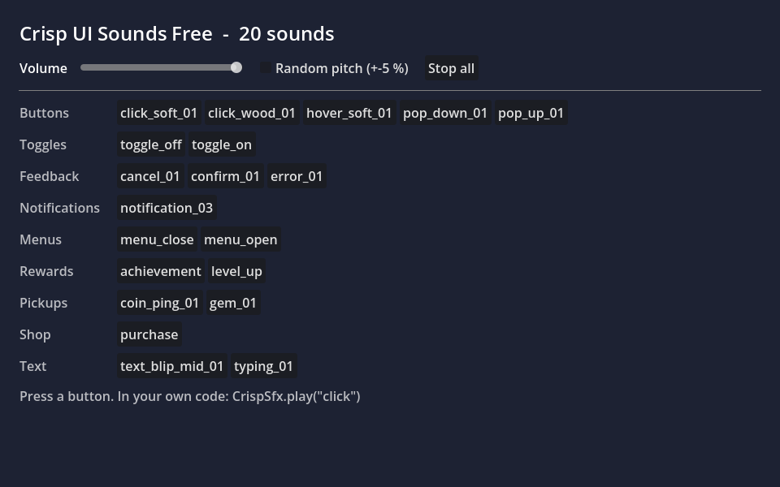

# Crisp UI Sounds Free

Twenty interface sounds for game menus, HUDs, rewards and pickups (Ogg Vorbis), and `CrispSfx`: a small autoload that
plays them by name with one line, lets overlapping sounds ring out instead of cutting each other off, and has volume,
audio bus and mute settings. It is the free sampler of [Crisp UI](https://anipixels.itch.io/crisp-ui).



## Install

**From the Asset Library (inside Godot):** open the **AssetLib** tab, search for "Crisp UI Sounds Free", press **Download**, then **Install**.
Everything lands in `res://addons/crisp_ui_sounds_free/`.
Then enable the plugin: **Project > Project Settings > Plugins > Crisp UI Sounds Free > Enable**. That registers the `CrispSfx` autoload.
(If you prefer not to use the plugin, add `res://addons/crisp_ui_sounds_free/crisp_sfx.gd` yourself under
**Project Settings > Globals > Autoload** with the name `CrispSfx`.)

**By hand:** download this repository (or `git clone` it) and copy the `addons/crisp_ui_sounds_free` folder into your project,
so that it sits at `res://addons/crisp_ui_sounds_free`. The scenes and resources point at that path, so keep the folder name.

To try the demo, open `res://addons/crisp_ui_sounds_free/demo/sounds_demo.tscn` and press **Run Current Scene** (F6).
A `git clone` of this repository also opens as a Godot project of its own and runs the demo with F5
(zip downloads leave `project.godot` out on purpose, so they contain only the `addons/` folder).

## Use

```gdscript
func _on_start_pressed() -> void:
    CrispSfx.play("click")                 # short name, or the file name: "click_soft_01"
    CrispSfx.play("coin", 0.05)            # +-5 % random pitch, so repeats do not sound robotic

func _ready() -> void:
    CrispSfx.bus = &"SFX"                  # your own audio bus (default: Master)
    CrispSfx.volume_db = -6.0              # or CrispSfx.set_volume_linear(0.5) from a slider
    CrispSfx.connect_buttons(self)         # click + hover sounds on every button under this node
```

Also there: `muted`, `max_polyphony` (default 8 voices), `stop_all()`, `has_sound(name)`, `get_sound_names()`, and
`add_sound("my_name", stream)` to play your own sounds through the same node. Sounds keep playing while the scene tree
is paused, so pause menus still click. `play()` returns the `AudioStreamPlayer` it used.

Short names: `click`, `click_wood`, `hover`, `pop_up`, `pop_down`, `toggle_on`, `toggle_off`, `confirm`, `cancel`, `error`,
`notification`, `menu_open`, `menu_close`, `achievement`, `level_up`, `coin`, `gem`, `purchase`, `blip`, `typing`.

## What is in it

| Category | Sounds |
|---|---|
| Buttons | `click_soft_01` (0.27 s), `click_wood_01` (0.34 s), `hover_soft_01` (0.32 s), `pop_down_01` (0.39 s), `pop_up_01` (0.38 s) |
| Feedback | `cancel_01` (1.31 s), `confirm_01` (1.44 s), `error_01` (0.53 s) |
| Menus | `menu_close` (0.50 s), `menu_open` (0.51 s) |
| Notifications | `notification_03` (1.45 s) |
| Pickups | `coin_ping_01` (0.92 s), `gem_01` (1.47 s) |
| Rewards | `achievement` (2.11 s), `level_up` (1.64 s) |
| Shop | `purchase` (1.54 s) |
| Text | `text_blip_mid_01` (0.33 s), `typing_01` (0.27 s) |
| Toggles | `toggle_off` (0.37 s), `toggle_on` (0.36 s) |

All sounds are loudness-matched, start on the first sample (no dead air) and peak at or below -1 dBFS.
`hover_soft_01` is mixed quiet on purpose, because hover sounds play constantly. Files (27, 265 KB):

- `./` - `LICENSE.txt`, `README.md`, `crisp_sfx.gd`, `plugin.cfg`, `plugin.gd`
- `demo/` - `sounds_demo.gd`, `sounds_demo.tscn`
- `sounds/` - 20 files (.ogg)

This repository has the OGG files only, to keep the download small. The 44.1 kHz 16-bit WAV versions of the same 20
sounds are in the free download on itch.io.

## Full pack

**[Crisp UI on itch.io](https://anipixels.itch.io/crisp-ui)** has **242 sounds** - these 20 and 222 more, as WAV and OGG: Buttons (56), Toggles (28),
Feedback (33), Notifications (24), Menus (20), Rewards (22), Pickups (25), Shop (10) and Text (24). That means several variations
of each click, hover and pickup (so you can pick one at random), matched pairs such as pop-up open / close, drawer open / close and
undo / redo, and star, combo and countdown sounds tuned to climb in order.

## Godot version

Written for **Godot 4.3 and newer** (GDScript only, no C#, no GDExtension, no feature known to need 4.4 or later).
Tested on **Godot 4.7.2 stable (the .NET editor build, run headless on Windows 11)**: headless import plus a script that loads every file and exercises the public API,
with no errors or warnings. It has **not** been run on 4.3 - 4.6; if something misbehaves there, please open an issue.

The audio was only checked for loading, length and playback state under Godot's headless (dummy) audio driver;
listen to the demo scene on your own machine to judge the sound.

## Licence

This free repository has two licences, both standard and both fine for commercial games:

- **Assets** - the sounds (OGG) and the demo scene (.tscn) - are under **Creative Commons Attribution 4.0 International (CC BY 4.0)**.
  Use, edit and ship them in anything, including commercial projects, as long as you give credit.
  A line like this in your credits is enough: `Crisp UI Sounds Free by Anipixels - https://anipixels.itch.io/crisp-ui`
- **Code** - every `.gd` file - is under the **MIT licence**.

See `LICENSE` (assets) and `LICENSE-CODE` (code); a copy of both is in `addons/crisp_ui_sounds_free/LICENSE.txt`.
This applies to the files in this repository only. The paid full pack has its own licence (no attribution needed, no redistribution).

## How it was made

The sounds are generated procedurally by code written with an AI assistant (Claude). No AI image or audio generators were used, and nothing is traced or taken from third-party assets.
